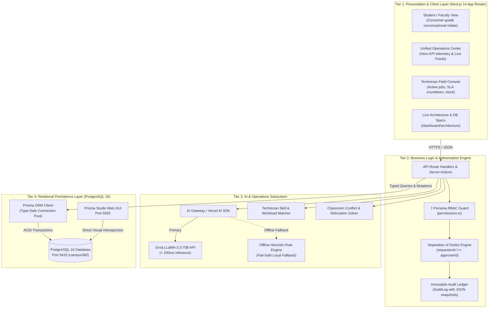
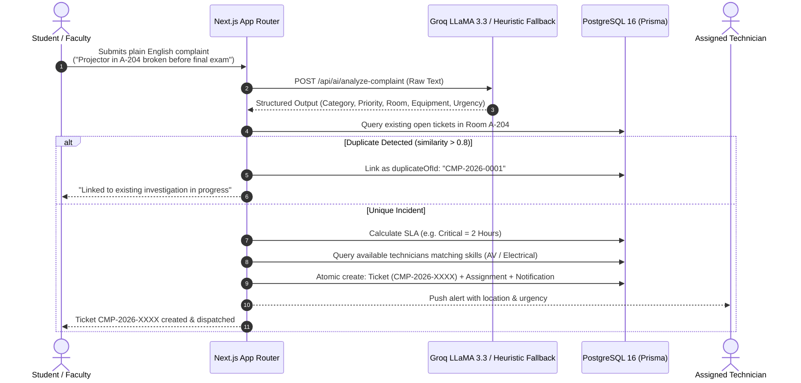
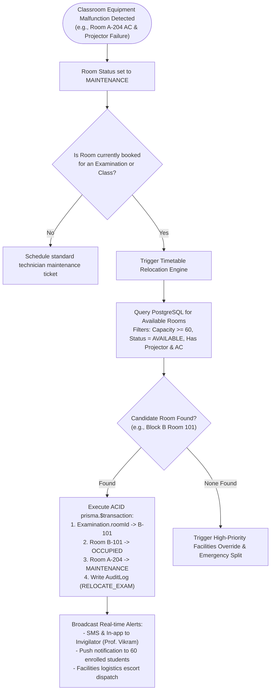
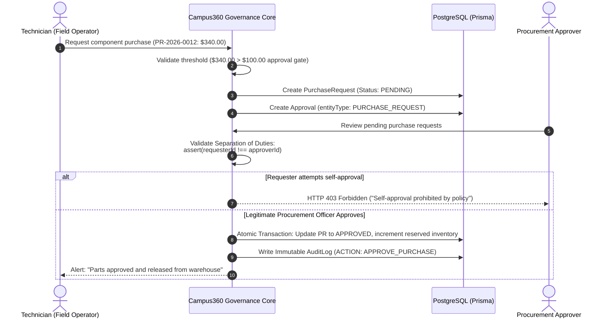
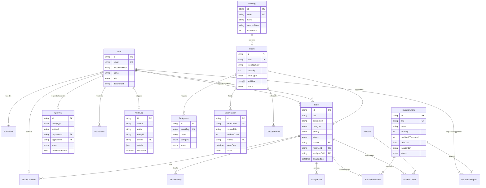

# Campus360 — System Architecture, Flow Diagrams & Database Schema Specification

> **AI-Powered Campus Operations & Intelligence Platform**  
> Hackathon Evaluation Blueprint & Technical Specification

---

## 1. System Architecture Diagram

Campus360 follows an enterprise-grade 4-tier modular architecture designed for high integrity, sub-200ms AI triage latency, strict role-based security boundaries, and ACID transactional consistency.



---

## 2. Core Workflow Diagrams

### Workflow A: AI-Powered Natural Language Incident Triage & Auto-Dispatch

This pipeline ingests unstructured student/faculty reports, runs NLP entity extraction, prevents duplicate dispatches, assigns SLAs, and pairs with the optimal technician.



---

### Workflow B: Automated Classroom Disruption & Exam Relocation

Autonomous timetable relocation algorithm resolving conflicts before exams or lectures are disrupted.



---

### Workflow C: Dual-Approval & Separation of Duties Governance

Enforces financial thresholds and prevents fraudulent self-approvals for parts and high-value repairs.



---

## 3. Database Schema & Entity-Relationship (ER) Model

The database is built on **PostgreSQL 16** and fully managed via **Prisma ORM**. It features 14 strongly typed relational models with foreign key cascade guarantees and indexing on query hot-paths.



---

## 4. How to Display the Database Schema to Evaluators

When evaluators ask to inspect your database schema, you have **three instant options**:

### Option 1: Live Interactive In-App Dashboard (Best & Fastest)
1. Open Campus360 at **`http://localhost:3000/dashboard/architecture`**
2. Click the **"3. Database Schema & ER Model"** tab.
3. Show the live model card breakdown (queries PostgreSQL directly in real-time).
4. Point out the real record counts: `Users: 8`, `Rooms: 6`, `Tickets: 4`, `Inventory: 4`, `AuditLog: 1`.

### Option 2: Live Prisma Studio Web GUI (Most Impressive)
Prisma Studio is already running in the background on port 5555.
1. Click the top-right button **"Open Live Prisma Studio (Port 5555)"** or navigate directly to **`http://localhost:5555`** in your browser.
2. In front of the evaluators, click on any table:
   - **`Ticket`**: Show real ticket codes like `CMP-2026-0001`, SLA deadlines, and foreign key relations.
   - **`Examination`**: Show the scheduled 60-student exam and how it links to `Room`.
   - **`AuditLog`**: Show the immutable JSON audit logs.
   - **`InventoryItem`**: Show warehouse bin locations and stock counts.
3. *Evaluator Proof*: If they think data is mocked, edit a record or create a ticket on the dashboard and click refresh in Prisma Studio — the new record appears immediately.

### Option 3: Terminal Inspection
If an evaluator asks to see the Prisma schema file directly:
```bash
# View the schema file
cat prisma/schema.prisma

# Verify PostgreSQL connection status
npx prisma db pull
```
